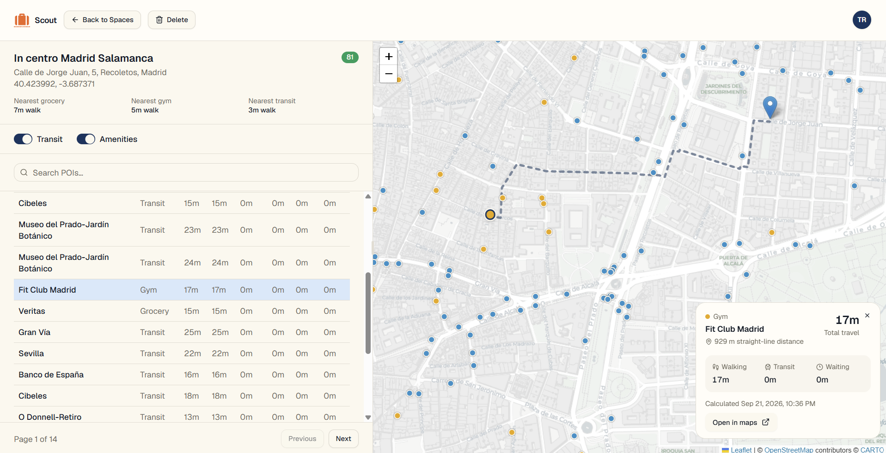
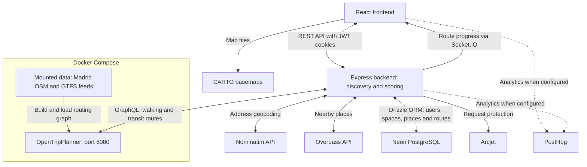

# Scout

I made Scout to help me find the perfect apartment location in Madrid using the city's open data sources. It helps study-abroad students compare apartments based on university commute times and access to everyday essentials. Save potential homes, explore the neighborhood, and compare how each location fits your routine.

## Features

- **Apartment shortlist:** Save potential homes and compare their scores in one dashboard.
- **Nearby essentials:** Find grocery stores, gyms, and transit stops on an interactive map.
- **Travel details:** Explore walking and public transit routes with calculated travel times.
- **Weighted scoring:** Compare livability based on how often you visit each type of destination.

## Tech Stack

- **Frontend:** React, TypeScript, Vite, Tailwind CSS, TanStack Query, and Leaflet.
- **Backend:** Node.js, Express, and TypeScript.
- **Database:** PostgreSQL on Neon with Drizzle ORM.
- **Location data:** Nominatim for geocoding and Overpass for nearby places.
- **Routing:** Self-hosted OpenTripPlanner with Madrid GTFS and OpenStreetMap data.
- **Authentication and protection:** JWT cookies and Arcjet.

## What it does

- Enter an apartment address to create a space and place it on the map.
- Discover nearby essentials and calculate travel times.
- Inspect routes and travel details for each location.
- Compare saved apartments using a combined livability score.

Routing currently focuses on Madrid.

## How it works

## Why I made it

I made Scout while searching for study-abroad housing. Checking the commute, nearby groceries, and neighborhood around every apartment meant repeating the same research across maps, spreadsheets, and notes. I wanted one place to do that work and compare the options. It also gave me a practical reason to build with geospatial data, public transit routing, and weighted scoring.

Made by Tejas Raman
